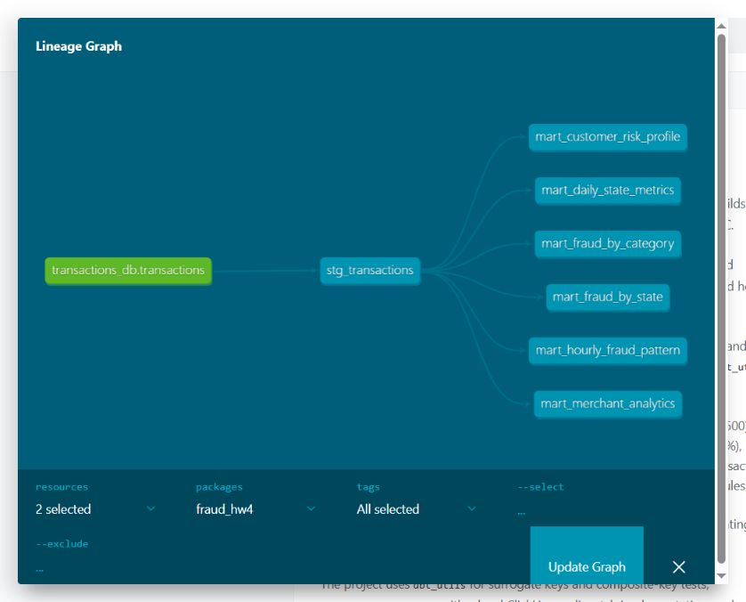

# HW4: dbt fraud analytics

Adds a dbt pipeline from `transactions_db.transactions` through `stg_transactions` to six marts. Docker Compose provides an independent ClickHouse instance. The CSV loader validates labelled input and atomically replaces the source; repeated imports do not add duplicates.

## Models

- `mart_daily_state_metrics`: daily state counts, amounts, average amount, P95 and large-transaction share.
- `mart_fraud_by_category`: transaction and fraud counts, amounts and fraud rate by category.
- `mart_fraud_by_state`: fraud metrics and distinct customer/merchant counts by state.
- `mart_customer_risk_profile`: customer history, amounts, fraud rate and risk level.
- `mart_hourly_fraud_pattern`: metrics by UTC hour and ISO weekday.
- `mart_merchant_analytics`: turnover, fraud rate, customer count and suspicious flag.

## Tooling

dbt-core **1.10.15**, dbt-clickhouse **1.9.8**, ClickHouse **25.3.6.56**. Includes `dbt_utils`, `dbt_date`, `dbt_expectations`, custom amount/customer/date macros, model and column descriptions, SQLFluff, pre-commit hooks and Make commands.

## Validation

- `make demo` and `make full` each passed twice, with separate fresh volumes for demo and train.
- Full dataset: **786,431 transactions**, **4,504 frauds**. Repeat imports preserved IDs, counts and aggregates.
- **166 dbt tests passed**: 158 data tests, including six singular tests, and eight native unit tests covering staging and all marts.
- **45 Python tests**, SQLFluff and all three pre-commit hooks passed.
- Independent CSV calculations matched every mart group: **186,752 full-data metric comparisons**.
- `dbt docs generate` and `dbt docs serve` completed successfully.

[Results](reports/hw4/RESULTS.md) · [Test log](reports/hw4/tests.log) · [Verification JSON](reports/hw4/verification.json)

